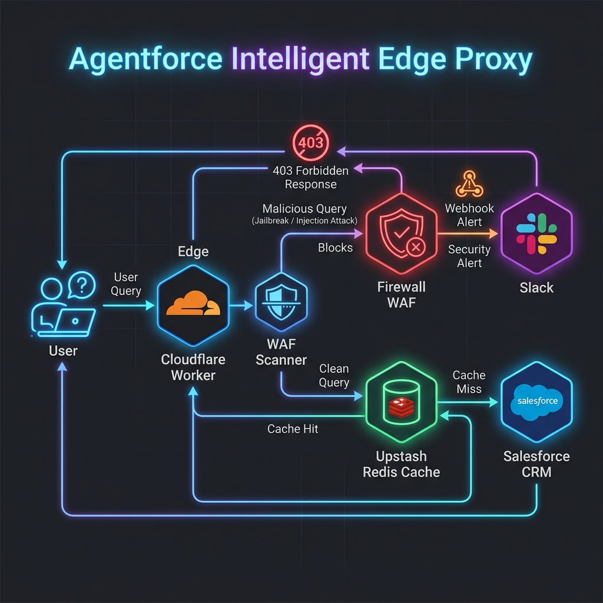

# Agentforce Intelligent Edge Proxy

Serverless proxy sitting between Salesforce Agentforce and Cloudflare Workers. Handles edge caching (Upstash Redis), prompt/SOQL injection blocking, cost tracking, and Slack alerts — all without touching the Salesforce API on cache hits.

---

## 🏗️ Architecture



---

## ⚡ Core Features

1. **Intelligent Edge Cache**:
   - Intercepts search queries from Agentforce and matches them against an **Upstash Redis** cache at the Cloudflare edge.
   - Delivers responses in **milliseconds** on cache hits, avoiding slow Salesforce API callouts.
2. **AI Prompt & SOQL Injection Firewall**:
   - Filters inputs through a real-time regex WAF scanner at the edge.
   - Detects and blocks prompt override scripts (`Ignore previous instructions`, etc.) and malicious SOQL payload segments before they touch Salesforce, writing the attacker's IP to a blacklist and automatically enforcing a `403 Forbidden` response block for any subsequent requests from blacklisted IPs.
3. **Telemetry & cost analytics dashboard**:
   - Logs execution time, cache hit/miss status, estimated token counts/costs, and user feedback (👍/👎 from Slack) to Redis.
   - Compiles these statistics into a real-time admin report.
4. **Smart Cache Invalidation**:
   - Integrates an Apex/Flow trigger webhook that purges cache entries in Upstash Redis whenever records are modified inside Salesforce.
5. **AI-Driven Cache Warming**:
   - Cloudflare Cron Triggers run background jobs to analyze search popularity (Sorted Sets) and proactively pre-fetch popular Salesforce records, ensuring instant cache hits for users starting their day.
6. **Slack ChatOps Command Room**:
   - Streams firewall block cards, cache invalidation alerts, and diagnostics metrics directly to Slack.
   - Features interactive Slack buttons to purge cache keys, run system diagnostics, or simulate custom prompt injection attacks.

---

## 🛠️ Advanced Performance & Security Optimizations

Designed with edge computing best practices to ensure high performance and low operational costs:

- **Local Isolate Memory Caching**: Caches the database version namespace in Cloudflare Worker global memory with a 15-second TTL. This avoids sequential Redis `get` calls on cache misses, reducing request latency by 10-30ms.
- **Redis Write Pipelining**: Groups metrics writes (sorted sets for popularity tracking, cost logs, total request metrics) into a single Redis pipelining packet, executing them in one network roundtrip in the background (`ctx.waitUntil`).
- **Non-blocking Telemetry execution**: Delays cost reporting and analytics tracking until after the client response is flushed, avoiding latency overhead for the end user.

---

## 📁 Repository Structure

```
├── cloudflare-worker/           # Wrangler project folder
│   ├── index.js                 # ES Module edge application containing routing & logic
│   ├── wrangler.toml            # Cloudflare Worker configuration & Cron triggers
│   └── package.json             # Worker dependencies
│
├── force-app/main/default/      # Salesforce DX Project Source
│   ├── classes/                 # Invocable Apex (Callouts, Telemetry Logging, and Invalidation Services)
│   ├── externalCredentials/     # External Credentials metadata
│   ├── namedCredentials/        # Named Credentials metadata
│   ├── permissionsets/          # Salesforce permission sets
│   ├── permissionsetgroups/     # Salesforce permission set groups
│   └── aiAuthoringBundles/      # Agentforce Agent Script definition
│
└── README.md                    # Project documentation
```

---

## 🚀 Setting Up the Project

### Prerequisites

1. **Salesforce Developer Edition Org**: Register a free org at [developer.salesforce.com/signup](https://developer.salesforce.com/signup).
2. **Cloudflare Account**: Sign up for a free account at [cloudflare.com](https://www.cloudflare.com/).
3. **Upstash Account**: Register for a free Redis serverless database at [upstash.com](https://upstash.com/).
4. **Slack App Integration**: Create a custom app on your Slack workspace at [api.slack.com/apps](https://api.slack.com/apps).

### Deploying the Cloudflare Worker

1. Navigate to `/cloudflare-worker` and install dependencies:
   ```bash
   npm install
   ```
2. Configure Wrangler secrets. Bind the following keys to your Cloudflare Worker environment:
   ```bash
   wrangler secret put UPSTASH_REDIS_REST_URL
   wrangler secret put UPSTASH_REDIS_REST_TOKEN
   wrangler secret put SLACK_WEBHOOK_URL
   ```
3. Configure local environment variables for testing:
   Create a `.dev.vars` file inside the `cloudflare-worker/` directory (see the [cloudflare-worker/.dev.vars](file:///home/rohit/Documents/Practice_projects/Agent/Exp/cloudflare-worker/.dev.vars) template) to supply your API credentials and configurations locally without committing them to Git.
4. Test your Worker locally:
   ```bash
   npm run dev
   ```
5. Deploy the Worker to Cloudflare's Edge:
   ```bash
   npm run deploy
   ```

### Deploying to Salesforce

1. Authorize your target Salesforce Org using the Salesforce CLI:
   ```bash
   sf org login web -a MyDevOrg -s
   ```
2. Deploy the metadata (Apex classes, Named Credentials, and Agent definitions) using SFDX:
   ```bash
   sf project deploy start
   ```
3. Assign the Permission Set Group `AFDX_User_Perms` to your integration users.
4. Populate the custom credentials secret in the Salesforce UI under **Setup > Named Credentials > External Credentials** to match the value of `PROXY_SHARED_SECRET` in your worker environment.
